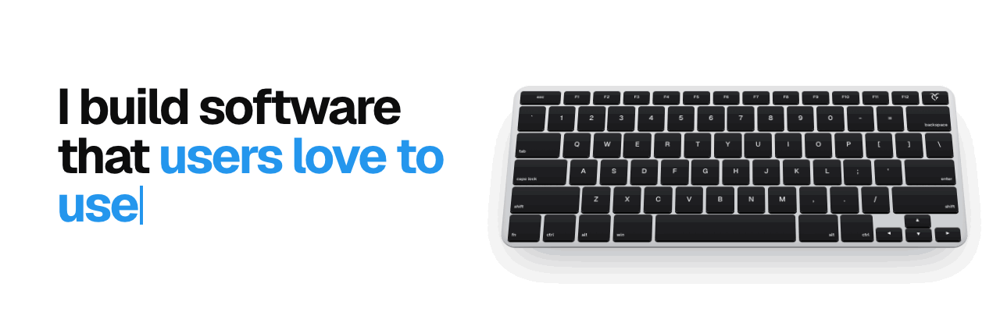

## Hi, I'm Beata

I'm a product engineer with a strong backend foundation, building software professionally since 2019. Today I'm a Senior Backend Engineer at Symmetrical.ai, working across the whole platform, from backend services to the frontend.

Most of my work is backend: system design, authorization and integrations between services. I like working where product meets engineering: talking with the business, figuring out what they actually need and turning it into software, from a rough idea to production and on through real user feedback.

I make the most of everything AI has to offer. Agents do a lot of the typing these days, which leaves me more time for the parts that need real thinking. Those I proudly keep for myself: understanding the problem, shaping the solution, then reviewing and testing everything before it ships. That way ideas reach production faster than ever without lowering the bar.

### What I work on

- **AI-assisted engineering:** internal tooling and a company-wide marketplace for agentic coding workflows
- **Platform architecture:** introduced multi-tenancy, so many organisations share one platform instance
- **Authorization:** led the design of an RBAC system based on OpenFGA, with fine-grained permissions across the platform
- **Event-driven systems:** integrations between microservices with Apache Kafka

<picture>
  <source media="(prefers-color-scheme: dark)" srcset="assets/banner-dark.gif">
  
</picture>

### Contact

[Website](https://beatakoziel.dev) · [LinkedIn](https://www.linkedin.com/in/bkozie%C5%82/) · beatakoziel.contact@gmail.com
